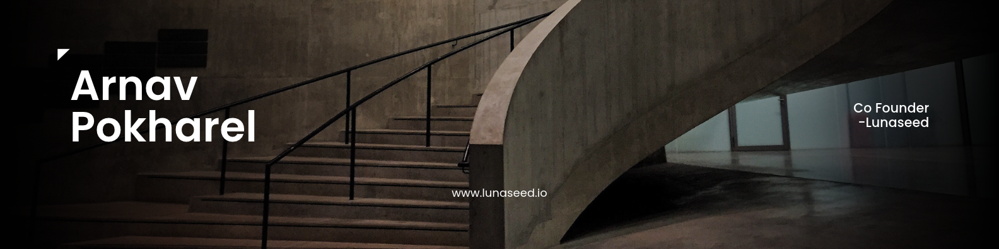

<!-- GITHUB PROFILE README | ARNAV POKHAREL -->

<!-- PERSONAL COVER IMAGE -->
<!-- Upload assets/cover.png and uncomment the next line when ready. -->
<!--  -->

# Arnav Pokharel

### Co-Founder & Engineering Lead at [Lunaseed](https://www.lunaseed.io)

**AI Infrastructure · Agentic Systems · Backend Engineering · Cloud Architecture**

Building intelligent systems that validate information, orchestrate complex workflows, and scale reliably.

[Portfolio](https://arnavworks.github.io) · [GitHub](https://github.com/arnavworks) · [Lunaseed](https://www.lunaseed.io) · [Founding Team](https://www.lunaseed.io/wefounders)

---

## About Me

I'm a software engineer and co-founder of **Lunaseed**, where I lead engineering, system architecture, and technical development.

I design and build scalable backend services, APIs, database systems, and cloud infrastructure while developing multi-agent orchestration workflows using **LangGraph and LLM-based pipelines**.

My engineering work includes:

- Stateful multi-agent orchestration and tool execution
- Scalable backend services and API architecture
- Distributed systems and asynchronous processing
- Data ingestion, extraction, classification, and validation
- Cloud infrastructure, CI/CD, and production deployments
- Authentication, authorization, and role-based access control
- Third-party integrations and secure data pipelines

My focus is on building **reliable, maintainable, secure, and production-ready AI systems**.

---

## What I'm Building

<table>
<tr>
<td width="100" align="center">

</td>
<td>

### [Lunaseed](https://www.lunaseed.io)

**Validation Infrastructure for Venture Capital**

Lunaseed helps venture firms transform fragmented documents, company disclosures, and live operating data into structured, source-verifiable intelligence for investment decisions.

**Co-Founder | Engineering & System Architecture**

</td>
</tr>
</table>

At Lunaseed, I lead the architecture and development of our core platform infrastructure, combining backend engineering, data processing, multi-agent AI systems, and cloud-native architecture.

Our platform is built around a unified validation engine and two connected environments: a founder workspace for evidence collection and an investor workspace for diligence and decision-making.

### Core Systems

#### 01. Veris — Validation Engine

An evidence-processing and validation system designed to establish a structured, verifiable record of company information.

**Engineering focus:**
- Multi-source data ingestion and classification
- Structured and unstructured data extraction
- Evidence normalization and reconciliation
- Cross-source and cross-pillar validation
- Contradiction detection and severity classification
- Immutable citation mapping and source traceability
- Stage-calibrated validation workflows

#### 02. Carter — Agentic Intelligence

An AI investigation and analysis layer for interacting with complex diligence records.

**Engineering focus:**
- LangGraph-based multi-agent orchestration
- Stateful agent workflows and execution management
- LLM reasoning pipelines and tool calling
- Context-aware retrieval and analysis
- Evidence-grounded question answering
- Cross-document reasoning and investigation
- Structured analytical outputs

#### 03. Flowdeck — Investor Workflow Infrastructure

The application layer connecting investor pipelines, company records, validation results, and collaborative diligence workflows.

**Engineering focus:**
- Backend services and API development
- Multi-tenant application architecture
- Authentication and role-based access control
- Investor pipeline and organization management
- Third-party integrations and data synchronization
- Secure evidence access and permissions
- Asynchronous processing and workflow coordination

---

## Technology Stack

### Languages

### AI & Agent Engineering

`Multi-Agent Systems` `LLM Orchestration` `Tool Calling` `Agent State Management` `RAG` `Structured Outputs` `Prompt Engineering`

### Backend & Data Engineering

`REST APIs` `Database Architecture` `Asynchronous Processing` `Background Workers` `ETL Pipelines` `Data Validation` `API Integrations` `Structured Data Processing`

### Cloud & DevOps

`CI/CD` `Cloud-Native Architecture` `Infrastructure Automation` `Observability` `System Reliability`

---

## Engineering Focus

| Area | What I Work On |
|---|---|
| **Agentic AI** | LangGraph, agent orchestration, state management, tool execution, multi-step workflows |
| **Backend Engineering** | APIs, service architecture, distributed processing, asynchronous workloads |
| **Data Infrastructure** | Extraction, transformation, classification, validation, evidence reconciliation |
| **Cloud Architecture** | Cloud-native applications, deployments, containers, infrastructure scaling |
| **Security** | Authentication, RBAC, tenant isolation, API security, secure data processing |
| **Platform Engineering** | CI/CD, infrastructure automation, observability, monitoring, reliability |
| **Integrations** | External APIs, live data sources, financial systems, developer platforms |

---

## Problems I Enjoy Solving

**Reliable Agentic Systems**

Designing AI workflows that coordinate reasoning, tool execution, state transitions, and external dependencies while handling errors and long-running tasks.

**Evidence-Driven AI**

Building systems that don't simply generate responses but validate information, identify contradictions, and trace conclusions back to source evidence.

**Distributed Backend Infrastructure**

Architecting maintainable backend services, asynchronous pipelines, and database systems capable of handling complex application workloads.

**Production AI Engineering**

Turning LLM prototypes into dependable systems through structured outputs, validation layers, observability, security, and controlled execution.

**Cloud Performance & Reliability**

Optimizing infrastructure architecture, processing latency, deployment workflows, operational stability, and cloud resource utilization.

---

## GitHub Activity

> Most of my current engineering work is focused on Lunaseed's private repositories and production infrastructure. Public GitHub activity represents only a portion of my development work.

---

## Beyond Engineering

I enjoy exploring systems beyond application development, including:

- Linux systems, networking, and self-hosted infrastructure
- Local LLM inference and distributed compute
- Hardware troubleshooting and electronics
- Developer tools and workflow automation
- Systems architecture and infrastructure optimization

I enjoy understanding how technology works at every layer, from hardware and operating systems to distributed applications and intelligent software.

---

## Connect

**Building intelligent systems, one layer at a time.**

